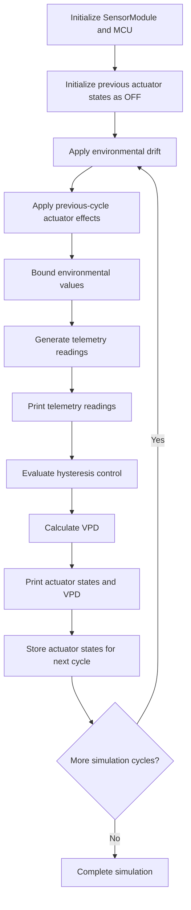

## V2.0: Current Implementation

The repository currently includes `terravision_twin.py`, a small greenhouse
simulation that:

- Maintains evolving environmental values for soil moisture, temperature,
  humidity, and a light index.
- Applies configurable randomized environmental drift once per cycle.
- Uses the previous cycle's actuator states to apply simplified environmental
  feedback before generating the next set of readings.
- Keeps the simulated environment within defined bounds.
- Estimates VPD using the simulated temperature and humidity.
- Prints five simulation cycles to the terminal.

This is a simplified illustrative simulation and an early step towards a digital
twin; it does not connect to the physical prototype or its sensors. The readings
are simulated, and the actuator states do not control real equipment. The light
reading is an index, not a PAR measurement. The script's thresholds and starting
values are illustrative and are not validated growing recommendations. The VPD
value is an estimate calculated from simulated temperature and humidity; it has
not been validated for agricultural use.

The environment update is intentionally simple and not a scientifically validated
greenhouse model. Environmental drift and actuator effect values are illustrative
and not calibrated real-world rates. The simplified feedback model does not aim to
model complex greenhouse interactions.

The actuator effects applied once per simulation cycle are:

- **Pump:** increases simulated soil moisture.
- **Fan:** decreases simulated temperature and humidity. The humidity reduction
  is an illustrative assumption.
- **Heater:** increases simulated temperature.
- **LED:** contributes a small simulated heat effect.

The script does not currently include a dashboard, data logging, real-time
hardware integration, or AI/ML features.

## System Workflow



### Hysteresis Control Behavior

The control logic uses separate ON and OFF thresholds for each actuator. This
prevents rapid switching around the control boundary while preserving actuator
states through their deadbands.

- **Pump:** turns ON when soil moisture falls below 30%. Once ON, it stays ON
  until moisture reaches 35% or higher, then turns OFF.
- **Heater:** turns ON when temperature drops below 18°C. Once ON, it stays ON
  until temperature reaches 20°C or higher, then turns OFF.
- **Fan:** turns ON when temperature exceeds 35°C or humidity exceeds 85%.
  Once ON, it stays ON until both temperature is at or below 32°C and humidity
  is at or below 80%.
- **LED:** turns ON when light falls below 300. Once ON, it stays ON until light
  reaches 350 or higher, then turns OFF.

These deadbands allow actuator states to persist through their respective
operating ranges and reduce rapid ON/OFF chatter around threshold values.

## Run the Simulation

Requires Python 3. No third-party packages are needed.

```bash
python terravision_twin.py
```

The script prints five cycles, with a short pause between cycles.

## Planned Development

Future work may include:

- Making the simulated environmental changes more realistic and configurable.
- Recording readings to a file and visualizing trends.
- Building a dashboard for the simulation.
- Exploring how a software model could represent the physical greenhouse.
- Investigating data analysis or AI-based features after the simulation and
  data are developed further.
- Exploring sensor or microcontroller integration as a separate future step.

These are plans, not completed features.

## Project Status

**Basic greenhouse simulation implemented with hysteresis-based simulated
actuator control and illustrative environmental feedback; further development
planned.**
